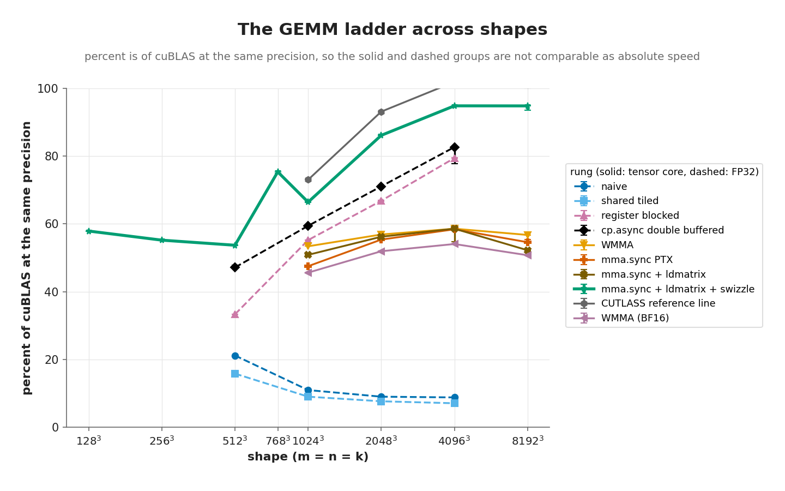
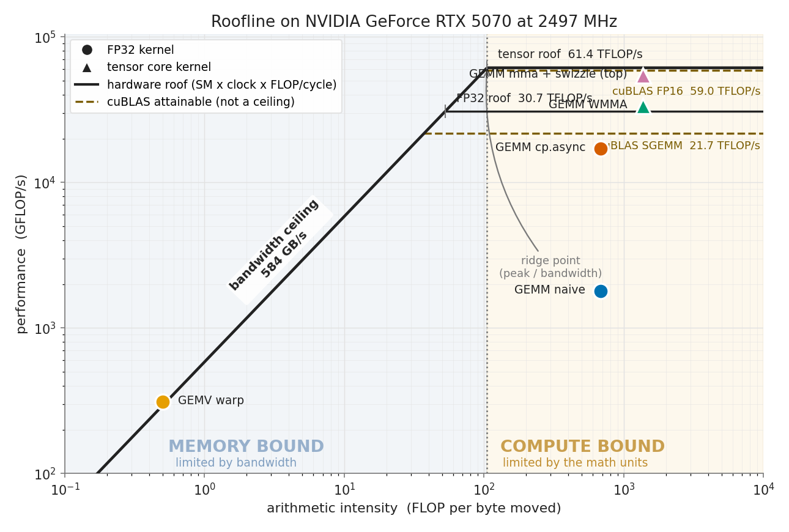
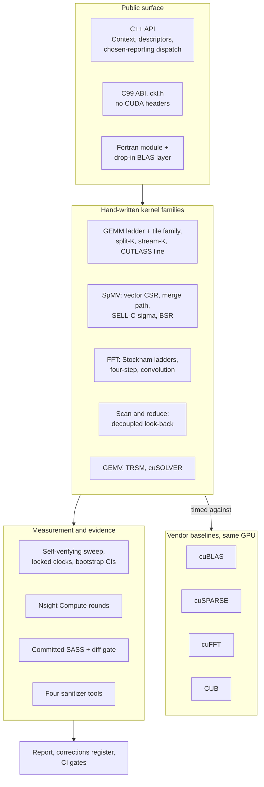

# MiniGEMM

A hand-written CUDA linear algebra library that starts from a naive GEMM and
walks it to **compute bound on the Blackwell tensor cores** — one profiler-guided
change at a time, with every performance claim measured against the vendor
library on the same GPU, in the same process, at a locked clock.

The library ships as `CKL`: a C++ API, a pure C99 ABI with no CUDA headers in it,
and a Fortran binding whose `SGEMM` drops in for a CPU BLAS.

**[Version 1.1.0](CHANGELOG.md)** · MIT · CUDA 13.3 · sm_120

---

## Quick start

```cmake
find_package(CKL REQUIRED)

add_executable(my_app main.cpp)
target_link_libraries(my_app PRIVATE ckl::ckl)
```

```cpp
#include "ckl/ckl.hpp"

ckl::Context ctx;

ckl::GemmDesc desc{};
desc.layout = ckl::Layout::kRowMajor;
desc.m = M; desc.n = N; desc.k = K;
desc.lda = K; desc.ldb = N; desc.ldc = N;
desc.algo  = ckl::Algo::kAuto;

ckl::Algo chosen = ckl::Algo::kAuto;
ckl::Status s = ckl::gemm(ctx, desc, &alpha, A, B, &beta, C, &chosen);
```

`gemm` is asynchronous on the context stream. `add_subdirectory` and pkg-config
work too, and C or Fortran callers can use the C ABI in [`include/ckl/ckl.h`](include/ckl/ckl.h)
without touching a CUDA header.

Four runnable programs live in [`examples/`](examples/): a minimal GEMM, a
strided-batched GEMM, the C ABI, and a custom stream plus workspace.

## Headline result

The GEMM optimization ladder, at 4096³ on an RTX 5070. Percentages are against
cuBLAS **at the same precision**, so the FP32 and tensor groups are not
comparable as absolute speed:

| rung | precision | GFLOP/s | % of cuBLAS |
|---|---|---|---|
| naive | FP32 | 1,810 | 8.8 |
| shared-memory tiled | FP32 | 1,455 | 7.1 |
| register blocked | FP32 | 16,378 | 79.4 |
| `cp.async` double buffered | FP32 | 17,047 | 82.7 |
| WMMA | FP16 | 33,722 | 58.6 |
| `mma.sync` PTX | FP16 | 33,627 | 58.4 |
| `mma.sync` + `ldmatrix` | FP16 | 33,729 | 58.6 |
| **`mma.sync` + `ldmatrix` + swizzle** | **FP16** | **54,602** | **94.8** |
| CUTLASS reference line | FP16 | 58,669 | 101.9 |
| WMMA | BF16 | 31,148 | 54.1 |

The shared-tiled rung being *slower* than naive is the most useful line in that
table: on a cache-rich GPU the optimization everyone reaches for first is a
regression here, and it stays on the ladder rather than being quietly dropped.



The curve is not flat — it climbs from 57.9% at 128³ through 66.4% at 1024³ to
86.1% at 2048³, because small shapes cannot fill 48 SMs. The honest single
figure is the geometric mean: **84.7%** over 1024³ to 8192³, **71.3%** over all
eight swept shapes.

Against a hardware roofline (48 SMs × 2,497 MHz locked × 512 FLOP/cycle for FP16
with FP32 accumulate) the top kernel reaches **89.0% of the compute roof**, and
cuBLAS reaches 96.2% of that same roof — the best evidence that 512 FLOP/cycle is
the right figure for this part.



GEMM sits far right of the ridge (compute bound); GEMV sits on the bandwidth
diagonal (memory bound), exactly as the model predicts.

## Beyond GEMM

Each family is measured against its correct vendor baseline on the same GPU.

| family | what is implemented | baseline |
|---|---|---|
| **GEMM** | ladder above, tile family, split-K, stream-K, CUTLASS line | cuBLAS |
| **SpMV** | vector CSR, merge path, SELL-C-σ, BSR | cuSPARSE |
| **FFT** | Stockham radix-2/4/8, four-step, convolution | cuFFT |
| **Scan / reduce** | Blelloch, decoupled look-back, Kahan, deterministic | CUB |
| **GEMV / TRSM / solver** | warp, vectorized, blocked; LU and Cholesky | cuBLAS, cuSOLVER |

Where the interesting results live is in *which kernel wins*, which turns out to
be a property of the matrix rather than of the kernel:

- **Merge path** on the power-law matrix `webbase-1M` runs **5.12× the
  warp-per-row kernel** (0.116 ms against 0.595 ms, disjoint CIs). Profiling
  attributes it to lane utilization — 29.71 of 32 lanes against 19.98 — paid for
  with a gather costing 11.05 sectors per request against 2.70.
- **BSR** takes `pdb1HYS` at 148.4% of cuSPARSE; **SELL-C-σ** takes `cant` at
  120.8%; the plain one-thread-per-row kernel takes `mc2depi` at 154.9%.
- On `soc-LiveJournal1` the BSR path **refuses to run**, and the row records why:
  the best block dimension would store 239,048,588 values for 68,993,773
  nonzeros, past the plan's entry ceiling. A recorded refusal, not a missing
  measurement — the table prints `refused`, not `pending`.
- **Convolution** is reported as a crossover rather than a percent, because the
  direct and FFT paths compute the same answer with different FLOP counts. At
  N = 2²² the direct path with taps in constant memory beats cuFFT by 23× at 8
  taps (0.081 ms against 1.860 ms) and loses by 5× at 4096 taps.

The FFT rung is not slow — it is doing too much work. At 2²⁴ it runs at 95% of
the DRAM roof on every one of its **8 passes**, where cuFFT makes **3**. Measured
traffic is 1977 MB against 744 MB, a ratio of 2.66, and the medians are 3.721 ms
against 1.427 ms, a ratio of 2.61. Those two ratios agreeing to 2% is the whole
diagnosis: **radix 8 is the wrong lever, the number of global passes is the
lever.**

## Architecture



## The method

The core of the project is a loop, not a single kernel. After each rung: run
Nsight Compute, name the top limiter, state a hypothesis, apply **exactly one**
change, re-measure.

Seventeen rounds are recorded in [`docs/DIAGNOSTIC_LOG.md`](docs/DIAGNOSTIC_LOG.md),
thirteen of them pointing at a committed `ncu` text page under
`experiments/results/ncu/`. Percent of cuBLAS is the headline against a vendor
library because it cancels the hardware out of the claim; the roofline uses the
hardware roof instead, so *percent of roof* and *percent of cuBLAS* stay two
different questions.

A plausible optimization that measured **worse** was reverted and written up, not
hidden. The corrections register in [`docs/CORRECTIONS.md`](docs/CORRECTIONS.md)
is where published claims get audited against the project's own data — including
the ones that did not survive.

### Evidence, not assertions

Every number comes from one sweep: **984 rows**, five independent process repeats
per configuration with a bootstrap 95% interval, the graphics clock locked at
2500 MHz and observed at 2497 with a worst drift of 1.0% against a 2% gate, and
the vendor baseline measured once per shape in the same process. Shapes are
measured both with L2 flushed and warm, and separately stream- and graph-launched.

The gates are stated up front and checked clause by clause. Misses are listed
next to the passes with the mechanism named, because **a gate that cannot fail is
not a gate**:

| gate | result | the miss |
|---|---|---|
| **GEMM compute bound** | 5 of 6 clauses pass | Compute ≥ 2× Memory Throughput fails at 8192³: 92.46 against 70.91, ratio 1.30. L2 residency, not the mainloop. |
| **SpMV** | one clause failed | Merge ≥ 1.5× warp on both power-law matrices: passes at 5.12× on `webbase-1M`, fails at 1.286× on `soc-LiveJournal1`. The gather, not load balance. |
| **FFT** | three clauses failed | Traffic within 15% of the model fails at 2²⁰ because the model has no L2 term; the best hand rung reaches 60.5% at 2²⁰ against a 70% of cuFFT bar. |
| **Scan / reduce** | bandwidth passed, CUB parity missed at two sizes | Scan within 5% of CUB fails at 2²⁶ (94.15%) and 2²⁷ (94.52%). It is tile size: look-back carries 2,048 elements per tile against CUB's 7,904. |

Full per-shape data with clocks, temperature, throttle flags and confidence
intervals: [`experiments/results/summary.csv`](experiments/results/summary.csv)
and [`experiments/results/tile_sweep.csv`](experiments/results/tile_sweep.csv).

## Build

Requires an NVIDIA GPU, a CUDA 13.3 toolkit, CMake ≥ 3.28, Ninja, and a host
compiler nvcc can parse (g++-14 here; see [`docs/building.md`](docs/building.md)).

```sh
make setup      # configure (CMake + Ninja, sm_120)
make build      # compile; zero warnings is a gate
make test       # correctness vs cuBLAS/cuSPARSE/CUB/CPU (needs a GPU)
make sweep      # full benchmark sweep -> experiments/results/summary.csv
make roofline   # measure the ceilings and render the roofline figure
make report     # regenerate figures/tables and build both PDFs
make all        # build + test + sweep + report + style gate
```

`make help` lists every target. Other build options — `multiarch`, `asan`, the
sanitizer set, `CKL_WERROR`, and the Fortran interface (`-DCKL_BUILD_FORTRAN=ON`)
— are documented in [`docs/building.md`](docs/building.md).

`sweep` locks the graphics clock before it measures anything and refuses to run
if it cannot, so rows within a sweep are comparable. Every result carries the
commit that produced it, and `make check-style` runs
`scripts/check_provenance.py`, which fails if a recorded hash no longer resolves
in git.

## Repository layout

```
include/ckl/      public headers: C++ API, C99 ABI, Fortran module
src/              api/ fft/ gemm/ gemv/ scan/ solver/ sparse/ telemetry/ trsm/
tests/            correctness tests against vendor oracles and CPU references
benchmarks/       per-family benchmarks, sweep driver, ncu driver
tools/            device probe, roofline CLI
docs/             per-component notes, build guide, diagnostic and engineering logs
experiments/      committed results: summary.csv, sweep.jsonl, ncu pages, SASS
report/           LaTeX report sources and generated figures
examples/         four runnable programs
fortran/          Fortran module, BLAS layer, its own tests and examples
scripts/          plotting, provenance, regression and style gates
```

## Documentation

| document | contents |
|---|---|
| [`docs/using.md`](docs/using.md) | integration, first program, and the load-bearing contracts: sync vs async, thread safety, alignment, aliasing, error handling, both layout conventions |
| [`docs/building.md`](docs/building.md) | toolchain, presets, build options |
| [`docs/gemm.md`](docs/gemm.md) | the ladder, tile family, heuristic behind `kAuto` |
| [`docs/sparse.md`](docs/sparse.md) | SpMV formats and the decision table |
| [`docs/fft.md`](docs/fft.md) | Stockham ladders, pass-count analysis |
| [`docs/scan.md`](docs/scan.md) | scan and reduction variants |
| [`docs/trsm.md`](docs/trsm.md) · [`docs/gemv.md`](docs/gemv.md) · [`docs/cusolver.md`](docs/cusolver.md) | the supporting families |
| [`docs/roofline_profiler.md`](docs/roofline_profiler.md) | how the ceilings are measured |
| [`docs/nvml_telemetry.md`](docs/nvml_telemetry.md) | clock, temperature and throttle gating |
| [`docs/sass.md`](docs/sass.md) | committed SASS and the diff gate |
| [`docs/benchmarking.md`](docs/benchmarking.md) | the measurement protocol |
| [`docs/DIAGNOSTIC_LOG.md`](docs/DIAGNOSTIC_LOG.md) | seventeen profiling rounds |
| [`docs/ENGINEERING_LOG.md`](docs/ENGINEERING_LOG.md) | the dated build log |
| [`docs/CORRECTIONS.md`](docs/CORRECTIONS.md) | audits of my own published claims |
| [`docs/DESIGN_DECISIONS.md`](docs/DESIGN_DECISIONS.md) | why the trade-offs landed where they did |
| [`docs/fortran.md`](docs/fortran.md) | calling it from Fortran |

## Reports

The PDFs are built from the committed results files and attached to each GitHub
release rather than committed to the tree, so a link points at a release asset
instead of a binary in `git`:

- **`main_report.pdf`** — design and optimization narrative, related work, the
  negative result, the numerical accuracy model, roofline analysis, limitations,
  and a reproducibility statement.
- **`debug_report.pdf`** — the dated engineering log.

Build them locally with `make report`, which regenerates every figure and table
from `experiments/results/`. It needs no GPU and no CUDA toolkit.

## Target machine

RTX 5070 (Blackwell GB205, compute capability 12.0, `sm_120`, 48 SMs, 12 GB
GDDR7), CUDA Toolkit 13.3, host compiler g++-14.3, built and run under WSL2
Ubuntu. The system GCC is 15.2, but nvcc 13.3 cannot parse its libstdc++, so the
build pins g++-14.

Measured ceilings — 61.4 TFLOP/s tensor roof, 30.7 TFLOP/s FP32 roof, 584 GB/s
streaming bandwidth — are captured on this machine by
`./build/tools/ckl_device_probe` and used everywhere in place of the datasheet.

## License and attribution

MIT. See [LICENSE](LICENSE). Third-party components, what the build links against
and what it fetches, are listed in [NOTICE](NOTICE); citation metadata is in
[CITATION.cff](CITATION.cff).
